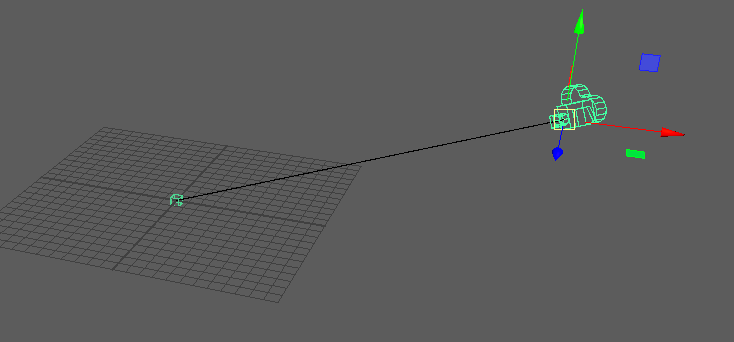
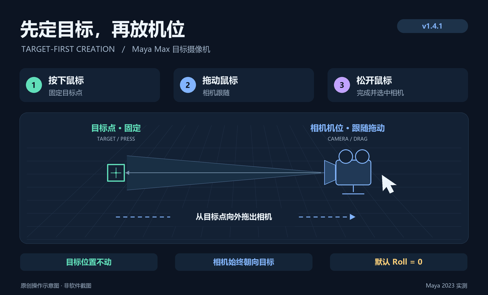
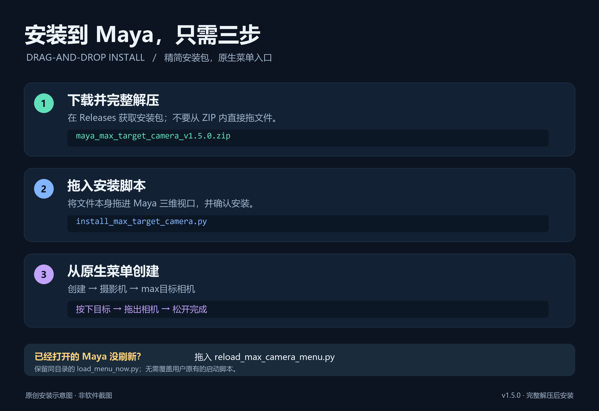
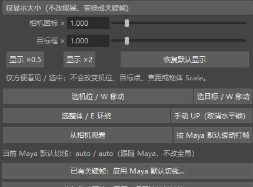

# Maya Max Target Camera

[中文](README.md) · [Download v1.5.1](https://github.com/510484034-cyber/maya-max-target-camera/releases/download/v1.5.1/maya_max_target_camera_v1.5.1.zip) · [Releases](https://github.com/510484034-cyber/maya-max-target-camera/releases/latest) · [Report an issue](https://github.com/510484034-cyber/maya-max-target-camera/issues)

**A 3ds Max-style target camera workflow for Autodesk Maya.** Drag-and-drop install, independent camera and target controls, horizon locking, editable focal length and roll animation, and native Create → Cameras menu integration. The current tool UI is in Chinese.

> **Press to anchor the TARGET → drag to position the CAMERA → release to finish.** The target stays at the original press position; the camera follows the pointer and is selected on release.
>
> Runtime tested in **Maya 2023 only**. Maya 2018–2026 is a compatibility target, not a list of certified versions.

## Real viewport example



*An existing-rig screenshot supplied by the author, cropped only. It illustrates the camera/target relationship, not the updated creation gesture. The current target-first gesture is explained by the original step diagram below.*



## Install

1. Download `maya_max_target_camera_v1.5.1.zip` from [Releases](https://github.com/510484034-cyber/maya-max-target-camera/releases/latest) and extract the complete archive.
2. Drag the **`install_max_target_camera.py` file** from your file manager into a Maya 3D viewport. Confirm installation.
3. Open **Create → Cameras → max目标相机**. The item starts interactive creation; its option box opens the parameter panel.
4. In the viewport, press for the target, drag out the camera, then release.

Do not drag from inside the ZIP, copy just one script, or overwrite your own `userSetup.py`. If Maya shows a script security prompt, review it yourself; this tool does not disable or bypass security settings.

If an already-open Maya session has not refreshed, drag **`reload_max_camera_menu.py`** into the viewport. Keep `load_menu_now.py` beside it.



## v1.5.1: stable maintenance release

- Retain the tested v1.5.0 target-first creation, independent camera/target controls, display-panel scaling and Maya-default key tangents. Their runtime behavior is unchanged.
- **Native-R camera display scaling is not included.** An unpublished prototype was discontinued after crashes during validation; it was not shipped in v1.5.0 either. Camera transform Scale stays locked, and this tool does not override Maya's R tool.
- **Resize a camera icon after creation** by selecting the camera and using the panel's display-only camera multiplier, double/halve buttons or reset. No rig recreation is needed.
- Existing target operations are retained. Prefer the target display multiplier for display-only changes; native R edits the target's transform Scale, which is a different channel.
- This is a scope, documentation and release-validation update, **not a new R feature or a claim to fix a crash in the previous public release**. Existing v1.5.0 users do not need to interrupt Maya for the same functionality; use the normal installer when the new version label and guide are desired.

## Display scaling and default tangents (retained from v1.5.0)



*Existing v1.5.0 panel crop; v1.5.1 keeps the same controls. This is not a new runtime-test screenshot.*

- Separate camera and target sliders / numeric multipliers, with double, halve and reset buttons. **Only display geometry changes**: no camera/target transforms, optical settings, target distance, transform Scale or animation keys are edited.
- Camera icon defaults to native Locator Scale = 1; the target box uses native-locator reference dimensions. Neither shrinks with drag distance anymore. Native Camera and Aim uses a screen-space pivot marker instead; this tool retains a scalable box, not an identical shape.
- Existing rigs are unchanged on reload. Use the display controls or reset explicitly; keyed, driven or locked display settings are refused rather than overwritten.
- New keys explicitly follow the current Maya tangent defaults, including user-selected Linear/Step settings. Existing hand-edited key tangents and global preferences remain untouched. An opt-in, confirmed command can convert direct rig curves to the current defaults without changing key times/values. Inter-frame motion changes, and the operation is undoable.

## Features and controls

- Independent camera and target translation: moving either does not translate the other.
- Default world-up horizon lock and zero initial Roll; translating with W does not add roll.
- Deliberate roll using the native **local Z rotation axis**, Rotate Z / Roll, or the panel. User-set roll and keyed animation are preserved.
- Native Focal Length and Lens controls, plus editable target distance in the panel.
- Separate target-box and camera-icon display scales.
- Near-view one-click placement and an explicit current-view camera-copy option.
- Explicit horizon repair and legacy-rig upgrades; loading code does not silently migrate scene cameras.
- Native Maya nodes: saved rigs do not need an external plug-in, expression, scriptNode, or persistent callback.

The installer writes only its own user module and backs up its managed files during reinstall. It does not alter the Maya installation, existing user startup scripts, `Maya.env`, or the current scene.

## Important limits

- A target camera is not a free camera: X/Y aim is driven by the target. This is not a full replacement for 3ds Max navigation or hotkeys.
- World-up has a pole singularity when the viewing direction aligns with the up axis. Use manual UP for these shots; manual UP disables world-horizon locking.
- `Target Distance (readout)` and native Center of Interest are measured values. Edit target distance in the tool panel.
- Copying the current viewport captures the evaluated pose/lens at one frame, not source animation.
- Referenced rigs and unsafe custom connections may be rejected by upgrade routines.
- Python 2.7 syntax checks are not evidence of runtime support for every older Maya release.

### Does this import `.max` scenes or 3ds Max camera animation into Maya?

**No.** It installs a Max-style target camera tool **inside Maya**. It does not read `.max` files or convert FBX/cross-DCC camera animation.

## Tests and packaging

v1.5.1 has 11 callback tests, 13 display/key-policy tests, 5 installer tests and 8 public-package checks (**37 total**). New checks guard version metadata, locked camera Scale, absence of the experimental adapter and deterministic archives.

These are **plain Python checks**, not Maya runtime tests. The earlier v1.5.0 release passed 18 display/easing checks and 24 existing regressions in a separate Maya 2023 GUI process; target-first native mouse dragging was also verified historically. This maintenance release changes no runtime-script logic except the version constants. No new Maya GUI validation was run, and historical results are not counted as new tests.

An optional [GitHub Actions configuration example](docs/ci-checks.example.yml) is included but not enabled by default. See [testing scope](docs/TESTING.md) and [changelog](CHANGELOG.md).

```bash
python -m unittest discover -s tests -p "test_*.py" -v
python tools/build_release.py
```

The release ZIP contains only six runtime/install scripts, the user guide, and the MIT license. It excludes development logs, tests, and older versions.

## License and artwork

[MIT](LICENSE). Documentation includes one authorized real Maya blank-scene viewport crop, a new-panel crop from a dedicated blank test process, plus two original watermark-free step diagrams clearly labeled **not software screenshots**. No generative editing was applied to the real screenshot. All images exclude desktop content, personal data and local workstation paths. The Chinese image captions are covered by the English steps above.

Independent community project; not affiliated with or endorsed by Autodesk. Product names identify intended compatibility and workflow only.
