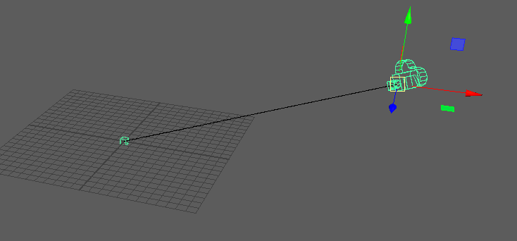
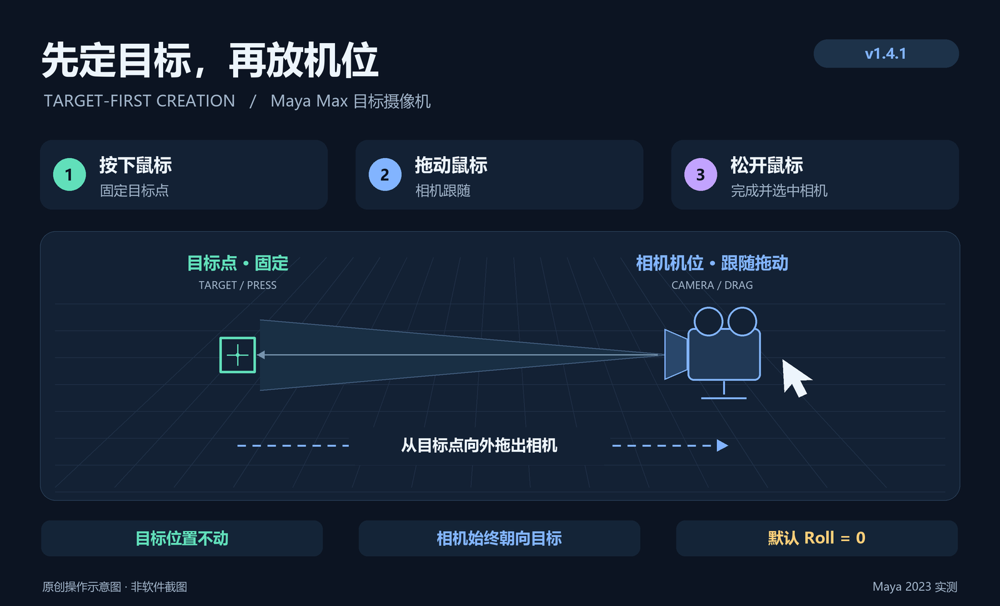
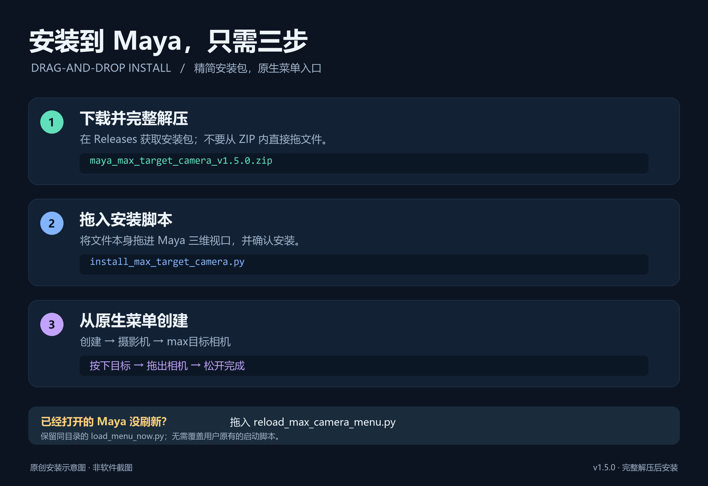
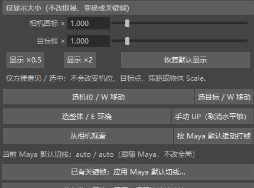

# Maya Max 目标摄像机 · Maya Max Target Camera

[English](README.en.md) · [下载 v1.5.1 安装包](https://github.com/510484034-cyber/maya-max-target-camera/releases/download/v1.5.1/maya_max_target_camera_v1.5.1.zip) · [完整使用说明](maya_max_target_camera/使用说明.md) · [反馈问题](https://github.com/510484034-cyber/maya-max-target-camera/issues)

**把 3ds Max 风格的目标摄像机工作流带入 Autodesk Maya。** 一个可拖拽安装的 Maya Python 相机工具：独立机位、独立目标、目标点优先拖动创建、默认水平锁定、可编辑焦距与滚转动画。

> **创建顺序：按下鼠标固定目标点 → 拖出相机机位 → 松开完成。** 不是先放相机再拖目标。
>
> 实测环境：**Maya 2023**。兼容目标为 Maya 2018–2026，但不代表这些年份均已实测。

## 真实视口示例



*用户提供的既有 rig 视口截图，仅裁切无关边缘；用于展示机位、目标与引导线，不代表新版创建过程。当前版本的目标优先拖动顺序见下方原创步骤图。*



## 下载与安装：如何把 Max 目标摄像机工具导入 Maya？

1. 在 **[Releases](https://github.com/510484034-cyber/maya-max-target-camera/releases/latest)** 下载 `maya_max_target_camera_v1.5.1.zip`，先完整解压。
2. 将解压目录里的 **`install_max_target_camera.py` 文件本身**拖进 Maya 三维视口，确认安装。
3. 打开 **创建 → 摄影机 → max目标相机**；点击名称进入拖动创建，点击右侧小方框打开参数面板。
4. 在视口里 **按下定目标 → 拖出相机 → 松开**，随后可用 W 移动选中的相机。

**不要在 ZIP 内直接拖文件，不要只复制单个脚本，不要覆盖自己原有的 `userSetup.py`。** 如果 Maya 显示脚本安全提示，请自行确认；工具不会关闭或绕过安全设置。

已有 Maya 会话未刷新？将 **`reload_max_camera_menu.py`** 拖进视口；保留与它同目录的 `load_menu_now.py`。



## v1.5.1：稳定维护版，保留已验证操作

- **保留 v1.5.0 的稳定功能**：目标点优先创建、独立机位和目标、面板显示缩放、Maya 默认缓动；本次不改变这些运行逻辑。
- **不包含摄像机 R 手柄显示缩放**：未公开发布的原型在验证中出现闪退后已停止，不纳入正式安装包；v1.5.0 也没有包含该实验。相机真实 Scale 继续锁定，工具不接管 Maya 的 R。
- **相机图标大小仍可在创建后调整**：选择相机 → 参数面板 → **仅显示大小 → 相机图标 ×**，也可使用 ×2、×0.5、恢复默认。无需重建相机。
- **目标点保留现有操作**。只想调整显示大小时优先使用“目标框 ×”；原生 R 修改的是目标变换 Scale，不应混同于独立显示通道。
- 这是稳定范围、文档和发布校验的维护更新，**不是新增 R 功能或对旧正式版作闪退修复的声明**。已使用 v1.5.0 的用户不必为相同功能中断当前 Maya 工作；需要新版标识和说明时可按上方步骤升级。

## 显示缩放与默认缓动（沿用 v1.5.0）



*沿用 v1.5.0 的真实面板裁切；v1.5.1 保留同样的控件，不作为本版新实测截图。*

- **独立显示缩放**：相机／目标各有滑块和数值输入，另有 ×2、×0.5、恢复默认按钮。只改变可见图形，不改变机位、目标点、旋转、物体 Scale、焦距、渲染画面或关键帧。
- **默认不再过小**：相机图标默认为原生 camera 的 Locator Scale = 1，目标框参考原生 locator 尺寸；不再随拖动距离自动缩小。原生 Camera and Aim 的目标使用屏幕空间枢轴标记，本工具保留独立可缩放方框，外形并不完全相同。
- **旧相机也可调整**：加载新版不自动改场景；选择旧相机后用“恢复默认显示”或倍率控制即可。已动画／被驱动／锁定的显示属性不会被覆盖。
- **默认缓动一致**：新关键帧明确采用 Maya 当前默认切线（如 Auto/Auto），不改变全局偏好；已有帧的手工切线保留。现有线性／阶梯曲线可通过需确认的按钮应用默认切线，时间和值不变，帧间运动会改变，可撤销。

## 功能

| 功能 | 行为 |
|---|---|
| 目标点优先创建 | 按下点固定为目标，机位随拖动变化；松开后选中相机 |
| 独立机位与目标 | 移动机位不平移目标；移动目标不平移机位 |
| 默认无额外翻滚 | 世界上方向锁定，Roll 初始为 0；W 移动不主动写入滚转 |
| 可编辑滚转 | 原生 E **本地 Z 轴**、Rotate Z / Roll，可打关键帧 |
| 可编辑镜头参数 | 原生 Focal Length、Lens、焦距面板；目标距离可在面板编辑 |
| 独立显示 | 相机／目标倍率、×2／×0.5／恢复默认；只改显示，不改镜头参数或动画 |
| 原生菜单入口 | 集成在 Maya 的 Create → Cameras／创建 → 摄影机 |
| 近距离一键创建 | 面板提供“视野内创建”，避免相机落在观察视口身后 |
| 旧相机回正与升级 | 显式操作，保留已有动画，不在加载脚本时自动改场景 |
| 原生节点相机 | 保存后的 rig 不依赖外部插件、表达式、scriptNode 或常驻回调 |

**安装器的边界：**只写入本工具的 Maya 用户模块目录，并在重装时备份自己的旧安装文件；不修改 Maya 安装目录、用户原有 `userSetup.py`、`Maya.env` 或当前场景。

## 常用操作

- **移动机位：**选相机，按 W。**移动目标：**选绿色小方框，按 W。
- **主动滚转：**E 的本地 Z 轴，或编辑 Rotate Z / Roll；已有滚转动画不会因为移动机位而被清零。
- **改目标距离：**使用面板输入框。通道盒 `Target Distance (readout)` 与原生 Center of Interest 是实时测量值。
- **修复旧相机意外倾斜：**面板“修复移动翻滚 / 回正（保留滚转关键帧）”。先保存自己的场景备份。
- **显示与参数：**修改通道盒或时间线之后，可点“刷新列表 / 参数”；关闭面板不影响相机工作。

## 兼容性与已知限制

- **只实测 Maya 2023。** 2018–2026 为兼容目标；Python 2.7 语法检查通过不等于其他 Maya 版本通过完整运行验证。
- 当前工具界面为中文；提供中英文仓库说明。
- 这是目标摄像机，不是自由相机；X/Y 朝向由目标求解。工具不会把 Maya 全部导航和快捷键变成 3ds Max。
- 镜头朝向与世界上方向平行时存在极点，附近仍可能翻转。需要此类镜头时使用手动 UP；它会退出默认水平锁。
- “复制视口机位”只复制当前帧的机位和镜头参数，不复制整段源动画。
- 引用相机或复杂自定义接线可能被拒绝自动升级，以保护用户修改。

### 能将 `.max` 文件、3ds Max 场景或相机动画导入 Maya 吗？

**不能。** 这里的“Max 目标摄像机导入 Maya”指**安装一个 Max 风格目标相机工具**，不是 `.max` 文件读取器、FBX 转换器或跨 DCC 动画迁移器。

## 验证与开发

v1.5.1 通过 **11 项拖动回调 + 13 项显示／缓动策略 + 5 项安装器 + 8 项公开包检查，共 37 项**。新增检查覆盖版本一致性、相机 Scale 锁定、无实验接管模块和可重复构建。

以上均为**普通 Python 检查，不启动 Maya，也不能代替 Maya GUI 验证**。此前 v1.5.0 已在独立 Maya 2023 空场景中完成 **18 项显示／缓动专项 + 24 项既有 GUI 回归**；目标优先真实鼠标拖动也有历史验收记录。v1.5.1 除版本常量外没有改变运行脚本逻辑，本轮没有重新进行 Maya GUI 验证，不把历史结果算作新增实测。

仓库另附可选 [GitHub Actions 配置示例](docs/ci-checks.example.yml)，默认未启用。[测试范围与本地运行方法](docs/TESTING.md) · [更新记录](CHANGELOG.md)

```bash
python -m unittest discover -s tests -p "test_*.py" -v
python tools/build_release.py
```

发布 ZIP 只包含 **6 个必要脚本、使用说明和 MIT 许可证**，不打包测试代码、开发日志或旧版本。

## 相关搜索词

Maya 目标摄像机、Maya 目标相机、Maya Max 目标摄像机、maya-max 目标摄像机导入 Maya、Maya 摄影机插件、Maya 相机脚本、Maya 相机目标点、Maya 无翻滚相机、Maya 拖动创建相机、3ds Max target camera for Maya、Maya target camera rig、Maya camera aim、Maya Python camera tools。

## 许可与图片

[MIT License](LICENSE)。文档包含用户授权的真实 Maya 空场景视口裁切、一张独立测试窗口中的新版面板裁切，以及两张原创、无水印的步骤示意图。**示意图明确标注为非软件截图**；所有图片均不包含桌面、账号、个人文件或本机路径。英文文字步骤见 [English README](README.en.md)。

本项目为独立社区工具，与 Autodesk 无隶属或背书关系；Maya、3ds Max 名称仅用于说明适用软件和工作流。
